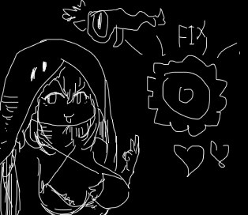

# Ancient Affection Compatibility Patch

Slay the Spire 2 **v0.113.1 (d09d48e5)**용 Ancient Affection v0.1.0 호환 패치입니다.
원작자는 **nagis**이며, 이 프로젝트는 비공식 후속 호환 패치입니다. UnifiedSavePath와는 별도 프로젝트입니다.

원본 모드 DLL을 직접 덮어쓰지 않고, 사용자의 설치본으로부터 수정된 로컬 복사본과 보조 모드를 만듭니다.
**모든 언어의 설명문·이름·이미지는 원본 PCK 그대로 유지합니다.**



창작마당 대표 이미지: 사용자가 직접 그린 원본 그림입니다.
제공된 PNG를 보정·재생성하지 않고 그대로 사용합니다.

## 적용 내용

- 삭제되거나 서명이 바뀐 게임 API 9종, 호출 지점 18곳을 현재 API로 연결합니다. 장갑의 `CardCmd.Exhaust`, 상인 재고 조회·무료 구매·카드 제거, 카드/유물 보상 생성 등이 포함됩니다.
- 고대인 선택지를 만들기 전에 해당 플레이어의 호감도·결혼 상태·선택지 관련 설정을 게임의 `PlayerChoiceSynchronizer`로 공유합니다. 다른 사람의 로컬 호감도로 임시 선택지를 만드는 원본 경로를 대체합니다.
- 강화 유물의 비전투 보상 난수 14곳을 플레이어별 난수로 옮깁니다. 서로 다른 플레이어가 보상을 받는 순서가 다음 전투의 공용 난수에 영향을 주지 않게 합니다. 전투 중 카드 생성/선택 난수는 유지합니다.
- 은 도가니·날개 장화·거대한 두루마리의 출현 조건을 새 `IsAllowedInternal` 훅으로 옮깁니다. 원래의 싱글/멀티 제한을 복원합니다.
- 만화경: 헌신 4개/총애 5개의 서로 다른 타 캐릭터 카드 선택지를 실제로 채웁니다. 보상은 2회이며 재추첨도 타 캐릭터 풀을 사용합니다.
- 장난감 상자: 사용자 요청대로 **밀랍 유물 3개 중 1개 선택 × 4회**로 변경합니다. 획득한 유물은 다음 선택 후보에서 제외합니다. 원래의 후보 고갈 시 Circlet 대체 동작과 헌신 4전투/총애 5전투당 용해 주기는 유지합니다. 이 변경은 설명문과 다른, 명시적으로 승인된 예외입니다.
- 유리 눈: 원본/헌신/총애 모두 보상 5개, 보상당 3장입니다. 일반 2회·고급 2회·희귀 1회 구성을 유지합니다. 강화 효과를 임의로 추가하지 않습니다.

## 빌드 및 설치

필수 환경: .NET 9 대상을 빌드할 수 있는 SDK, 위 게임 버전, 원본 Ancient Affection v0.1.0, BaseLib, STS2-RitsuLib.
현재 검증 환경은 BaseLib 3.4.8 및 RitsuLib의 `compat/0.113.0` 런타임입니다.
빌더는 검토한 원본 DLL의 SHA-256을 검사하므로 다른 원본 버전에는 적용하지 않습니다.

```powershell
./BuildAndVerify.ps1
```

위 기본 명령은 저장소 폴더가 게임 설치 폴더 바로 아래에 있을 때 사용합니다.
다른 위치에 내려받았다면 게임 경로를 지정하십시오. 예:

```powershell
./BuildAndVerify.ps1 -GameDir 'D:/SteamLibrary/steamapps/common/Slay the Spire 2'
```

원본 모드가 기본 Workshop 경로에 없다면 `-OriginalModDir`로 지정할 수 있습니다.
현재 검증 도구는 같은 Steam 라이브러리의 BaseLib(`3737335127/BaseLib`)와 RitsuLib(`3747602295/compat/0.113.0`, `3747602295/shared`) 설치를 사용합니다.

생성물은 `dist/candidate/AncientAffection`와 `dist/candidate/AncientAffectionCompat`입니다.
빌드 스크립트는 게임의 `mods`와 Workshop 설치본을 변경하지 않습니다.

게임을 종료한 상태에서 다음 명령을 실행하면 검증 후 두 폴더를 `mods`에 복사합니다.
기존 로컬 폴더가 있으면 이 프로젝트의 `backups`에 복사해 둡니다.

```powershell
./Install.ps1
```

설치 스크립트도 `-GameDir`로 게임 경로를 지정할 수 있습니다.

원본과 같은 모드 ID를 유지합니다. 로컬 복사본 버전은 `v0.1.0+compat.1`로 원본과 동일한 버전 우선순위를 갖습니다.
현재 게임 로더는 같은 ID·같은 버전의 로컬/Workshop 설치가 있으면 로컬을 사용합니다.
모드 목록에서 Ancient Affection과 보조 패치를 활성화해야 합니다. 보조 패치는 수정된 원본의 의존성으로 먼저 로드됩니다.
멀티플레이 참가자 전원이 **동일한 패치·게임·의존 모드 버전**을 사용해야 합니다.
승천/지옥 등 별도 모드 기능의 게임플레이 설정도 참가자 간 동일하게 맞추십시오.
되돌릴 때는 게임을 종료하고 이번에 설치한 두 로컬 폴더를 `mods` 밖으로 옮긴 뒤, 필요한 경우 백업을 복원합니다.
Workshop 구독 원본과 기존 저장 데이터는 삭제하지 않습니다.

## 검증 범위와 한계

- 74계열, 강화 유물 156종의 한국어 설명과 효과 코드 대조: [AUDIT.md](AUDIT.md).
- 추가 유물 전체 173종의 생성·복제·변수 초기화, 원본 타입 614개 로딩.
- 원본 메서드 2,462개 JIT 컴파일, 게임 API 참조와 가상 훅 연결, 원본 Harmony 패치 전체 및 보조 패치 적용.
- 상인 재고 기록·보상 구성·장갑 1~4턴의 소유자 판정/힘/소멸 시점·6종 출현 제한 동작 검증.
- 실제 게임 선택 동기화 클래스를 사용한 메모리 전송 테스트: 메시지 선도착/후도착, 선택 번호 일치, 잘못된 데이터 거부, 다른 호감도 스냅샷이 끼어들어도 동일한 유물 계획 생성.
- 서로 다른 플레이어의 보상 순서를 바꿔도 결과 유지 및 공용/전투 난수 불변 확인.
- 원본과 생성된 PCK의 SHA-256 일치 확인. 설명문 파일 수정 없음.

격리 테스트는 화면·명령 실행 일부를 대역으로 바꿉니다. 장갑 테스트는 실제 효과 함수가 호출하는 힘/소멸 명령과 대상을 검사하며, Godot 전투 화면까지 실행하지는 않습니다.
Godot이 필요한 상인 미니게임 생성 코드 6개는 일반 .NET JIT 사전 준비 검사에서 제외했습니다.
**실제 두 PC의 협동 전투, UI 선택 화면, 중도 저장/재접속은 아직 검증하지 않았습니다.**
승천/지옥·결혼/친밀도 전용 선택 분기의 전체 기능 회귀 검증도 완료된 것으로 주장하지 않습니다.
이 패치는 확인한 강화 유물 경로와 API 오류를 수정한 테스트 후보입니다.

원본 자산/역컴파일 소스의 재배포 허가를 가정하지 않습니다. 공개 배포 시에는 이 프로젝트의 자체 소스와 빌더를 배포하고, 원본 DLL/PCK가 포함된 `dist/candidate`는 사용자의 설치본에서 생성하십시오.
